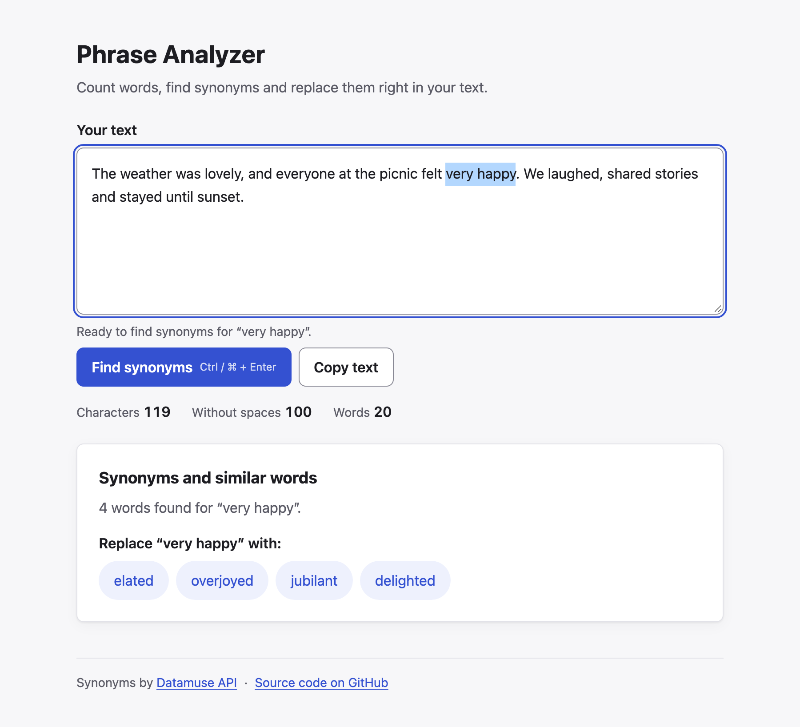

# Phrase Analyzer

Type or paste text, select a word or a short phrase, get synonyms from the [Datamuse API](https://www.datamuse.com/api/) and replace the selection with one click. The app also counts characters and words and copies the whole text to the clipboard.

**Live demo:** https://opokhvalenko.github.io/phrase-analyzer/



## Features

- Character count (also without spaces) and word count, updated while you type
- **Find synonyms** for the selected word or phrase (button or `Ctrl / ⌘ + Enter`)
- Click a synonym to replace the selection; the original case is kept (`Happy` → `Pleased`, `HAPPY` → `PLEASED`)
- After a replacement the new word stays selected, so you can look it up again; **Undo** reverts the last replacement
- **Copy text** copies the whole text
- Loading, empty and error states with a **Try again** button; works with the keyboard and screen readers
- Light and dark theme (follows the system setting); all colours pass WCAG AA contrast

## Getting started

Requires Node.js 22.12+.

```bash
git clone https://github.com/Opokhvalenko/phrase-analyzer.git
cd phrase-analyzer
npm ci
npm start            # http://localhost:4200
```

| Command | What it does |
|---|---|
| `npm test` | unit and component tests (Vitest) |
| `npm run e2e` | end-to-end tests in Chromium, Firefox and WebKit (Playwright; run `npx playwright install` once) |
| `npm run check` | lint and format (Biome) |
| `npm run typecheck` | TypeScript for app, unit tests and e2e |
| `npm run build` | production build |

## Tech stack

- **Framework:** Angular 21 — standalone components, signals, zoneless change detection, `OnPush`, new control flow
- **HTTP:** `HttpClient` + RxJS (`switchMap` cancels the previous request, `timeout`)
- **Styles:** SCSS with CSS custom properties, no UI library
- **Tests:** Vitest + jsdom (unit, component), Playwright in Chromium, Firefox and WebKit (e2e)
- **Quality:** Biome, husky + lint-staged + commitlint, GitHub Actions (lint → typecheck → unit → build, e2e)
- **Deploy:** GitHub Pages, only after CI passes on `main`

I kept it to one screen without a router or a state library: for a single page, signals in a small store are enough, and the whole app is ~52 kB gzipped.

## Decisions

The task leaves some cases open. This is how I handled them and why.

| Question | Decision |
|---|---|
| Synonyms for a **phrase** | Datamuse's strict synonyms (`rel_syn`) return nothing for phrases, so I use `ml=` ("means like"), which works for both words and phrases. That is why the panel says "synonyms and **similar** words". |
| Unrelated words in results | For phrases Datamuse appends filler results ("very happy" → "agony", "cosmetic"). They start at the first item tagged `results_type:backfill…`, so I cut the list there. This is observed behaviour, not a documented contract: if the tag is missing, the full list is shown. |
| Selection with spaces or punctuation (`" happy, "`) | Trimmed to the word; the spaces and the comma stay in the text. |
| Part of a word selected (`app` in `happy`) | Expanded to the whole word, otherwise the replacement would produce `hpleasedy`. |
| Nothing useful selected | **Find synonyms** is disabled and a hint says why: nothing selected, no letters, or more than 5 words (a phrase, not a paragraph). |
| Text or selection changes after the lookup | The replacement target is captured when the lookup starts. Editing the text clears the synonyms and cancels the request, so a synonym can never land in the wrong place. |
| Ctrl+Z after a replacement | Setting `textarea.value` from code clears the browser's undo history, so there is an **Undo** button for the last replacement. `document.execCommand('insertText')` would keep native undo, but it is deprecated and isn't implemented in jsdom, so it can't be covered by unit tests. |
| What is a "character" | A user-perceived character: 👍🏽 and `é` count as 1 (`Intl.Segmenter`). Selection offsets stay in UTF-16 units, the same as `selectionStart/End`. |
| What is a "word" | Letters or digits in any script; `don't`, `well-known` and `мʼята` are one word. Non-English text is counted correctly, but Datamuse only knows English, so lookups show "No synonyms found". |
| Repeated lookups | Successful results are cached per phrase (`Happy` = `happy`); errors are not cached, so **Try again** really retries. |

## Project structure

```
src/app/
├── core/
│   ├── api/datamuse/       client (HTTP, timeout, cache), response DTO and mapper
│   ├── clipboard/          wrapper over the Clipboard API
│   └── errors/             any failure → network | timeout | server | unknown + message
├── features/text-analyzer/
│   ├── text-analyzer.page  connects the textarea, buttons and panels to the store
│   ├── text-analyzer.store signals state: text, selection, synonyms, undo
│   └── components/         text-stats, synonym-panel (inputs/outputs only)
└── shared/
    ├── text/               pure functions: counting, selection, replacement, case
    └── ui-text.ts          all UI strings in one place
e2e/                        Playwright tests, Datamuse mocked with page.route
```

## Tests

- **145 unit and component tests.** Text helpers cover the edge cases above (empty text, emoji, Ukrainian, backwards selection, the 5-word limit). The API client is tested with `HttpTestingController` (encoding, cache, every error type, timeout). The store is tested with a fake client to check cancellation, double clicks, retry, replace and undo.
- **11 e2e tests, each run in Chromium, Firefox and WebKit** with the API mocked. Text is selected with Shift+Arrow keys, like a user would. Running all three engines paid off: Firefox collapses a selection only after `mouseup`, so the app also listens to `selectionchange` on the textarea.
- I checked that the tests fail when the logic breaks: I temporarily broke key lines (`switchMap` → `mergeMap`, no cache, no selection listeners…) and each change made at least one test fail.

## What I would add next

- Save the text in `localStorage` so it survives a reload
- Multi-step undo/redo history
- Highlight all occurrences of the selected word
- Move to `httpResource` once it is stable in Angular

## Use of AI

I used an AI assistant (Claude) for planning, finding edge cases and writing parts of the code and tests. I reviewed every change, ran the app in the browser against the real API, and kept only what I can explain. Testing in a real browser mattered: that is how the filler results Datamuse returns for phrases, the duplicate accessible name on the textarea and the Firefox selection issue were found — none of them showed up in unit tests.
